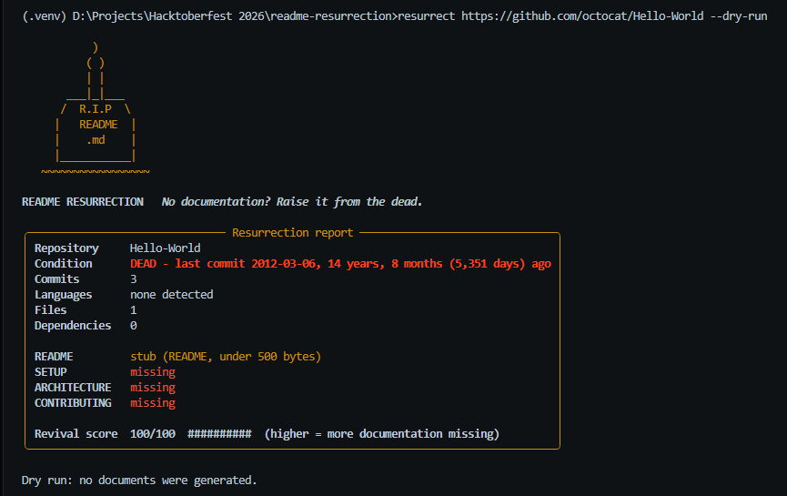

# README Resurrection

> No documentation? Raise it from the dead.

README Resurrection analyzes a code repository and writes the documentation it's missing: **README, SETUP, ARCHITECTURE and CONTRIBUTING** files, generated from the real source by a **local, open-weight model**. Nothing leaves your machine, and no API key is needed.

**Docs:** [Setup](SETUP.md) · [Architecture](ARCHITECTURE.md) · [Contributing](CONTRIBUTING.md)



## Why this exists

Abandoned projects often have good code and no explanation. Asking an LLM to "write a README" on a repo tends to produce confident guesses: invented install commands, flags that don't exist, modules that never call each other. This tool is built around that failure mode. The model writes prose, and plain code supplies the facts and checks the result.

## How it works

1. **Scan (plain code, no model).** Collects the file tree, languages, dependency files, entry points, scripts, tests, license type, tooling files, and, for Python, the real import graph.
2. **Read git history (plain code).** Last commit date, commit count, contributors.
3. **Summarize key files (local model).** Each important file gets a 2-3 sentence summary. Results are cached by file content, so re-runs are fast.
4. **Write four documents (local model).** Each prompt contains only the scanned facts and the summaries, plus a list of *verified commands* the model is allowed to use. Anything the facts don't cover must be written as `unknown` or `TODO: confirm`.
5. **Verify (plain code).** Every file path, shell command, and "X imports Y" claim in the output is checked against the repo. Anything that fails is listed under `## Needs review` at the end of the document.

In ARCHITECTURE.md, the "How the pieces fit together" section is not written by the model at all. It is rendered directly from the import graph, so it is complete and correct by construction.

## Requirements

- Python 3.10 or newer
- [Ollama](https://ollama.com) running locally
- `git` on your PATH (for GitHub URLs)

## Install

```bash
git clone https://github.com/AbbeyIT/readme-resurrection
cd readme-resurrection
python -m venv .venv
# Windows:      .venv\Scripts\activate
# macOS/Linux:  source .venv/bin/activate
python -m pip install .
ollama pull qwen2.5-coder:7b
```

To run the tests, install the dev extra first: `python -m pip install ".[dev]"`, then `python -m pytest`.

## Usage

```bash
# Preview the Resurrection report only (no model needed)
resurrect <path-or-github-url> --dry-run

# Generate all four documents into ./resurrected
resurrect <path-or-github-url>

# Examples
resurrect . --out ./resurrected --max-files 12
resurrect https://github.com/owner/repo --skip contributing
resurrect ./old-project --model qwen2.5-coder:3b
```

| Option | Meaning |
|---|---|
| `--out` | Output folder (default `./resurrected`). |
| `--model` | Any Ollama model name (default `qwen2.5-coder:7b`). |
| `--max-files` | How many source files to summarize (default 8). |
| `--skip` | Skip a document: `readme`, `setup`, `architecture`, `contributing`. Repeatable. |
| `--dry-run` | Print the report and stop. No model calls. |
| `--no-verify` | Skip the verification pass. |

GitHub URLs are shallow-cloned to a temporary folder that is deleted afterward.

> **Careful with `--out .`:** it writes the documents into the current folder and will overwrite files with the same name, such as your existing `README.md`. Use `--skip` for any document you want to keep.

A good rule of thumb is to set `--max-files` to the number of source modules in the repo. With too few, the model has no summary for some files and writes "unknown" for them.

## The Resurrection report

Before any generation, the tool prints what state the repo is in. Here is the dry run on GitHub's oldest demo repo:

```
╭─────────────────────────────── Resurrection report ───────────────────────────────╮
│ Repository     Hello-World                                                        │
│ Condition      DEAD - last commit 2012-03-06, 14 years, 8 months (5,351 days) ago │
│ Commits        3                                                                  │
│ Languages      none detected                                                      │
│ Files          1                                                                  │
│ Dependencies   0                                                                  │
│                                                                                   │
│ README         stub (README, under 500 bytes)                                     │
│ SETUP          missing                                                            │
│ ARCHITECTURE   missing                                                            │
│ CONTRIBUTING   missing                                                            │
│                                                                                   │
│ Revival score  100/100  ##########  (higher = more documentation missing)         │
╰───────────────────────────────────────────────────────────────────────────────────╯
```

A repo is **alive** under 180 days since its last commit, **dormant** up to 730 days, and **dead** beyond that. The **revival score** is simple arithmetic: README is 40 points, and SETUP, ARCHITECTURE and CONTRIBUTING are 20 each. Each missing document adds its points, and a README under 500 bytes counts as missing. Higher means more documentation is missing.

This repository went through it too. Its first report scored **60/100** (a README, but no SETUP, ARCHITECTURE or CONTRIBUTING), and **40/100** once ARCHITECTURE.md had been generated.

## Why local and open

- **Private code stays private.** The model runs on your machine, so unreleased or proprietary code is never uploaded.
- **Works offline** once the model is pulled.
- **Swappable.** `--model` accepts any Ollama model, and all model access lives in one small module (`resurrect/llm.py`).
- **Free to run.** No API keys and no per-token cost.

## Performance

Measured on a Windows laptop with **no GPU** (the model runs 100% on CPU), using `qwen2.5-coder:7b` with a 4,096-token context:

| Step | Time |
|---|---|
| README.md | 1m 28s |
| SETUP.md | 1m 30s |
| CONTRIBUTING.md | 1m 45s |
| ARCHITECTURE.md | 3m 52s |
| **Whole run** (4 files summarized, 4 documents, verification) | **11m 42s** |

ARCHITECTURE is the slowest because its prompt also carries the file tree and import list. Summaries are cached, so re-running on an unchanged repo skips that step: a later run that regenerated only SETUP and CONTRIBUTING, with all nine summaries already cached, took **3m 27s** in total. A GPU, or a smaller model through `--model`, will be faster.

## Example output

This tool documents itself, and the generated files are in the repo root:

- [`SETUP.md`](SETUP.md)
- [`ARCHITECTURE.md`](ARCHITECTURE.md)
- [`CONTRIBUTING.md`](CONTRIBUTING.md)

They were generated by running `resurrect . --out . --max-files 9` on this repository. The model wrote the descriptions, and the import section in ARCHITECTURE.md was rendered by code from the real imports.

I read the output and corrected it by hand before committing, which is the intended workflow: the tool gives you a grounded first draft, and you review it. Two examples of why that matters:

- **The verifier caught the model going beyond the facts.** In the first CONTRIBUTING.md, the model added `git clone` and `git checkout -b` commands that nothing in the repo backs. They were flagged under `## Needs review` for a human to accept or remove.
- **The verifier can't catch everything.** The model described `opencode.json`, which isn't a source file and had no summary, as "Open source project metadata". It is actually the config that points the opencode agent at a local Ollama model. I corrected it by hand.

## What it does not do

- **The verifier checks accuracy, not completeness or prose.** It catches paths that don't exist, commands the repo doesn't back, and wrong import claims. It cannot tell that a list is missing an item or that a one-line description of a module is slightly off. Read the output before publishing it.
- **Bare one-word commands aren't checked.** A command in backticks with no arguments, such as `resurrect`, passes through unverified.
- **The import graph is read for Python only.** For other languages, ARCHITECTURE falls back to `TODO: confirm` for how modules connect.
- **Files with no summary may be described loosely.** Non-source files such as configuration files are not summarized, so the model either marks them unknown or guesses from the file name. Raise `--max-files` to cover more source files.
- **It summarizes a limited number of files** (8 by default), so very large repos get a high-level picture.
- **A small model is still a small model.** The design reduces invented content, but doesn't remove it.
- **Path checks are skipped** for repos with more than 2,000 files, because the file list is truncated.

## Project layout

```
resurrect/
  cli.py        command-line entry point and pipeline
  scanner.py    repo facts, dependencies, license type, import graph
  gitinfo.py    git history facts
  fetch.py      GitHub URL cloning to a temp folder
  llm.py        the only module that talks to Ollama
  summarize.py  per-file summaries with a content-hash cache
  docs.py       the four document generators and the verified-commands list
  verify.py     checks generated docs against the repo
  report.py     banner, Resurrection report, revival score
tests/
examples/
```

## License

[MIT](LICENSE)